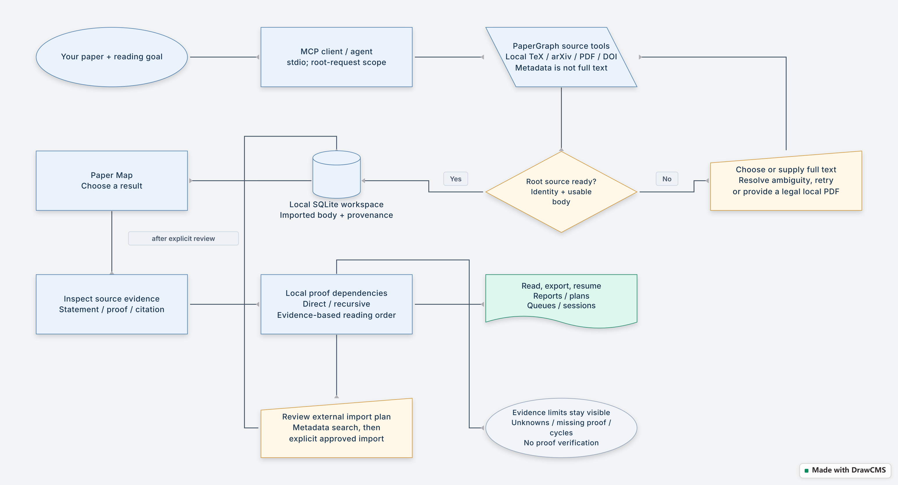

<div align="center">

# PaperGraph MCP

[](https://github.com/lotchuazzz-crypto/papergraph-mcp/actions/workflows/ci.yml)
[](https://www.python.org/)
[](LICENSE)
[](https://github.com/lotchuazzz-crypto/papergraph-mcp/releases)

**Read math papers with evidence, not guesses.**

Turn arXiv papers, local LaTeX projects, and born-digital PDFs into a local theorem-centered workspace. Inspect source-backed results, proofs, citations, and dependencies; save reading progress and export Markdown reports.

</div>

## What You Can Do

- Start with a **Paper Map**: inspect structure, main-result candidates, and external reading risks before choosing a theorem.
- Trace statements and proof-local references back to source slices; inspect direct and recursive dependencies, shared prerequisites, cycles, and unknowns.
- Discover public full-text candidates for DOI papers and review scholarly reference matches from Crossref, OpenAlex, and arXiv.
- Keep queues, sessions, checkpoints, notes, and open questions in local SQLite workspaces. Export **Reading Reports** and **Cross-Paper Reading Plans**.

## Quick Start

Install [uv](https://docs.astral.sh/uv/getting-started/installation/), then check the pinned package. No Git or checkout is required:

```sh
uvx --from papergraph-mcp==1.2.2 papergraph-mcp --version
uvx --from papergraph-mcp==1.2.2 papergraph-mcp doctor
```

[PyPI 1.2.2](https://pypi.org/project/papergraph-mcp/1.2.2/) is published and has passed [public-package and Git-free Linux acceptance](docs/reference/v1.2.2-publication.md). Diagnostics do not independently verify publication.

For an MCP client accepting JSON-style stdio configuration:

```json
{
  "mcpServers": {
    "papergraph": {
      "command": "uvx",
      "args": ["--from", "papergraph-mcp==1.2.2", "papergraph-mcp"]
    }
  }
}
```

Restart the client after configuration. A bare server launch waits quietly for a stdio MCP connection; CLI commands also work without an MCP client.

For agent-assisted setup, use the repository's [setup skill](.agents/skills/setting-up-papergraph/SKILL.md) from the freshly fetched remote default revision. Preserve existing branches and local changes; ask before installing software, changing client configuration, or restarting. The optional Git-source route requires Git and live verification of the exact `v1.2.2` tag against the reviewed package source; see the setup skill.

## Read Your First Paper

[](docs/assets/papergraph-request-flow.png)

[Editable DrawCMS source](docs/assets/papergraph-request-flow.drawcms).

1. Keep the workspace database outside the repository. Preview inputs with `plan-starter-project`; it validates files without importing or writing. Run `bootstrap-reading-project` after review to create the workspace and reading artifacts. Local LaTeX inputs must name the main `.tex` file.
2. Open the Paper Map and Evidence Triage, choose a result, then inspect its statement, proof, source slices, and dependency evidence.
3. Review external import plans, save checkpoints and notes, and export a report or cross-paper plan. Follow the [first-workspace walkthrough](docs/walkthroughs/first-workspace.md) for commands and examples.

For raw arXiv requests, use `load_arxiv_request`; conflicting IDs or links require user selection before loading. For DOI discovery, `discover-doi DOI` finds candidates without downloading. `add-doi-paper WORKSPACE DOI` can import a requested root paper when exactly one eligible public PDF exists; multiple candidates require selection.

For an existing workspace, replace the placeholders with actual IDs:

```sh
uvx --from papergraph-mcp==1.2.2 papergraph-mcp get-paper-map --workspace WORKSPACE --paper-id PAPER_ID
uvx --from papergraph-mcp==1.2.2 papergraph-mcp get-dependency-reading WORKSPACE PAPER_ID --target-result-id RESULT_ID --detail compact
```

Arguments are command-specific: check each command's `--help`. Compact dependency output retains access to full evidence.

## Evidence Boundaries

- PaperGraph does **not** verify proofs, infer hidden prerequisites, or establish semantic theorem equivalence. Empty dependencies do not prove independence; extracted reading orders are not complete mathematical dependency graphs.
- Long PDFs support raw source pagination through `workspace_read_source_blocks` and its `next` handle. New automatic PDF proof evidence covers only the first physical line with an explicit proof heading; ownership can remain unknown, and later proof references remain unknown. Raw continuation is readable but does not become dependency evidence automatically. Existing excerpts retain their extraction policy until explicit reimport.
- External references become reviewable plans, not automatic downloads. [Bounded reference expansion](docs/walkthroughs/bounded-reference-expansion.md) requires an explicitly approved finite policy; ambiguous matches await review. Metadata is not full text, and no workflow bypasses paywalls.
- Papers and reading state remain local. Back up workspaces before schema upgrades; older versions cannot open schema 9.

## Documentation

- [v1.2.3 preparation notes](docs/reference/v1.2.3-release-notes.md) (not yet public-index verified)
- [Local LaTeX extraction and independent acceptance](docs/reference/latex-extraction.md)
- [Core contract](docs/reference/v1-core-contract.md) · [Historical v1.1.5 client evidence](docs/reference/client-compatibility.md)
- Examples: [Reading Report](docs/examples/reading-report-example.md) · [Cross-Paper Reading Plan](docs/examples/cross-paper-reading-plan-example.md) · [Reference Search](docs/examples/reference-search-example.json) · [Reference Resolution](docs/examples/reference-resolution-example.json)
- Starter outputs: [Summary](docs/examples/starter-summary-example.md) · [Manifest](docs/examples/papergraph-starter-manifest-example.json)
- [v1.2.2 release notes](docs/reference/v1.2.2-release-notes.md) · [Publication evidence](docs/reference/v1.2.2-publication.md) · [Artifact verification](docs/reference/v1.2.2-artifact-verification.md)
- [Contributing](CONTRIBUTING.md) · [MIT License](LICENSE)
